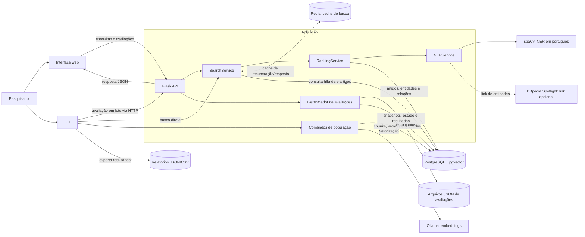
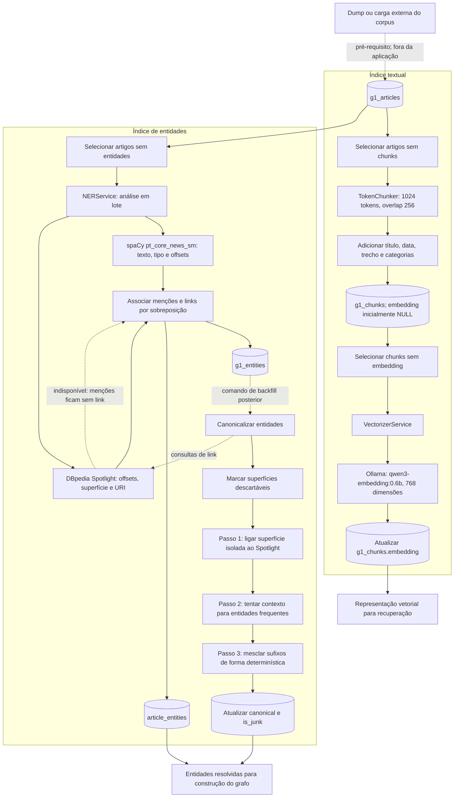
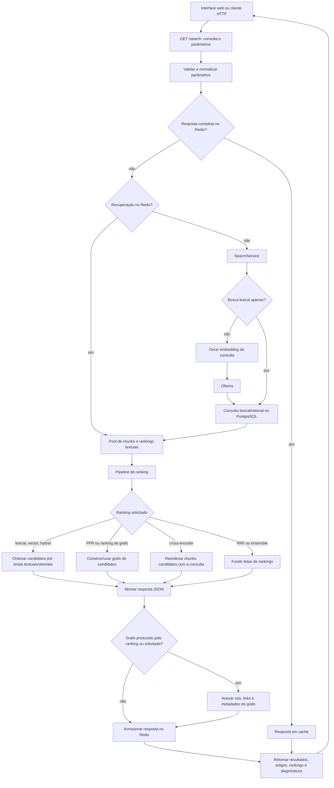
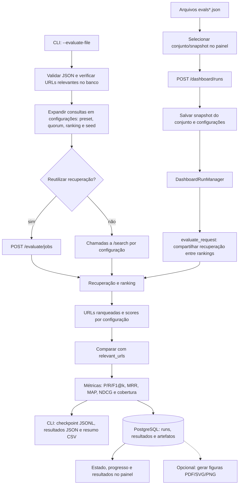
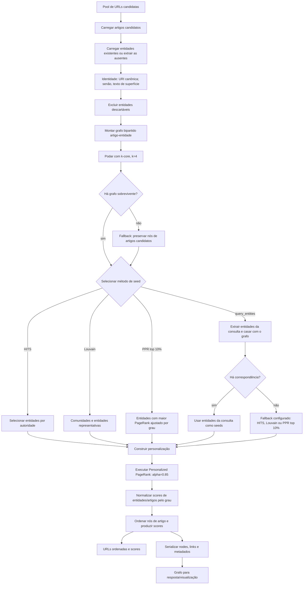

# Diagramas dos fluxos de execução

Os diagramas documentam os principais limites do sistema, transformações de dados e artefatos produzidos. O corpus G1 deve estar previamente carregado em `g1_articles`; a aplicação não o importa automaticamente.

## 1. Contexto do sistema

**Entradas:** consultas, parâmetros de busca, comandos de população e conjuntos de avaliação.  
**Saídas:** resultados de busca, estado/resultados de avaliação e arquivos de relatório.  
**Finalidade:** situar os principais componentes e serviços externos antes de detalhar cada fluxo.

## 2. Preparação do corpus e indexação

**Entradas:** artigos já armazenados em `g1_articles`, incluindo URL, título, data, metadados e corpo textual.  
**Saídas:** chunks, embeddings, menções de entidades, relações artigo-entidade e identidades canônicas.  
**Finalidade:** mostrar os processos offline que preparam os dados usados pela recuperação textual e pelo grafo.

O carregamento do dump é uma etapa externa. A aplicação executa chunking, vetorização, extração de entidades e canonicalização como comandos de população separados.

## 3. Busca online e ranking

**Entradas:** consulta e parâmetros como janela de datas, `top_k`, quorum, unidade de resultado, estágio, ranking e método de seed.  
**Saídas:** chunks recuperados, artigos ordenados com scores e, opcionalmente, dados do grafo, diagnósticos e tempos.  
**Finalidade:** explicar o caminho da requisição desde o cache até a resposta da API.

O ranking é configurável; o diagrama agrupa as alternativas para manter o fluxo legível. A resposta atual contém resultados recuperados/ordenados, não uma resposta narrativa gerada por LLM. A sumarização disponível no código não está conectada ao endpoint `/search`.

## 4. Avaliação em lote e painel

**Entradas:** avaliações com consultas e URLs relevantes, além de presets, quorums, rankings, seeds e unidade de resultado.  
**Saídas:** rankings por configuração, métricas, cobertura, tempos e relatórios persistidos ou exportados.  
**Finalidade:** documentar a avaliação experimental e diferenciar o caminho do CLI do caminho persistente do painel.

No painel, a avaliação é executada pelo gerenciador da aplicação e os resultados são gravados incrementalmente no PostgreSQL. O CLI também pode usar o endpoint de jobs para compartilhar a recuperação; sem reutilização, faz chamadas de busca independentes. A geração de figuras é uma etapa posterior que lê rodadas já persistidas.

## 5. Construção do grafo e ranking PPR

**Entradas:** URLs dos artigos candidatos, entidades associadas, consulta (para `query_entities`) e parâmetros/método de seed.  
**Saídas:** scores e ranking dos artigos candidatos, além de uma representação serializada de nós e arestas.  
**Finalidade:** detalhar a etapa de grafo do fluxo online, em especial como entidades canônicas influenciam o Personalized PageRank.

O diagrama detalha o caminho PPR. Outros rankings de grafo disponíveis — por exemplo, RWR, HITS, SALSA, caminhos e caminhadas — compartilham a preparação do grafo, mas podem usar cálculos e critérios de ordenação diferentes.

## Referências no código

- `src/app.py`: comandos de população e composição dos serviços.
- `src/services/chunking.py`, `src/services/vectorizer.py`, `src/services/ner.py` e `src/services/linking.py`: preparação de chunks, embeddings e entidades.
- `src/api.py`, `src/services/search.py` e `src/services/search_pipeline.py`: API, recuperação e seleção do ranking.
- `src/services/ranking.py`: construção do grafo e PPR.
- `src/services/batch_evaluation.py`, `src/services/batch_search.py` e `src/services/dashboard_runs.py`: avaliação em lote e painel.
