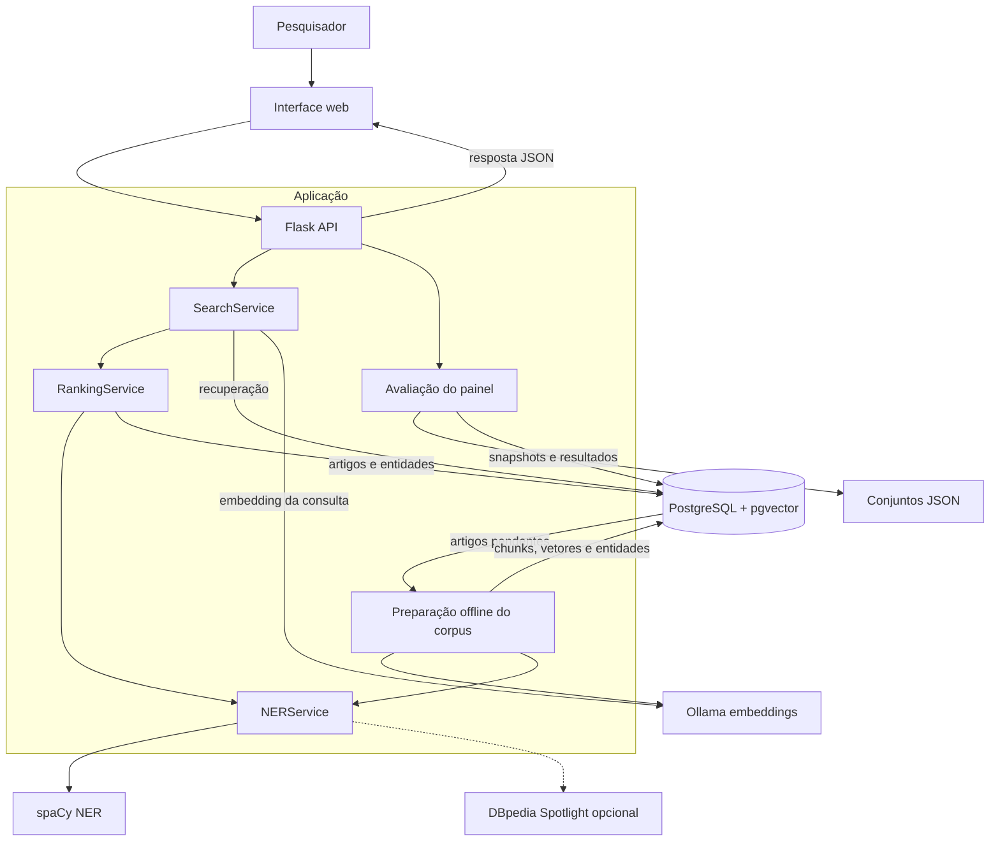
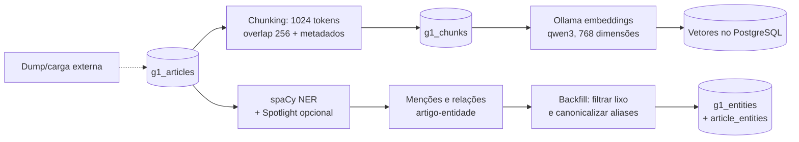
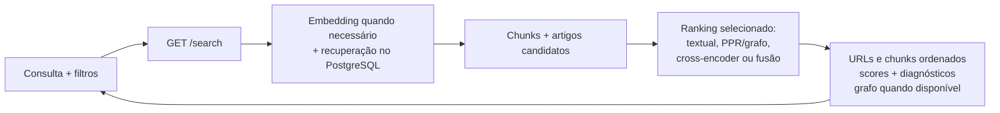
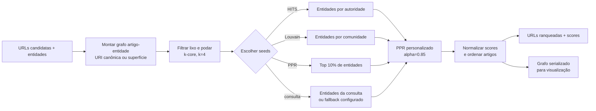

# Fluxos de execução — versões sem cache Redis e sem CLI

Estas versões mantêm os cinco fluxos da documentação principal, mas mostram apenas os caminhos da interface web e dos serviços centrais. Os diagramas 2 e 5 não precisaram de alterações porque já não mostravam Redis nem CLI.

## 1. Contexto do sistema

**Entradas:** consultas pela interface web, conjuntos de avaliação e artigos existentes.  
**Saídas:** resultados de busca, avaliações persistidas e artefatos de análise.  
**Finalidade:** apresentar a aplicação, os serviços externos e o PostgreSQL sem os detalhes de cache e dos comandos de linha de comando.



## 2. Preparação do corpus e indexação

**Entradas:** artigos já armazenados em `g1_articles`.  
**Saídas:** chunks, embeddings e relações entre artigos e entidades.  
**Finalidade:** mostrar a preparação offline que alimenta a recuperação textual e o grafo.



## 3. Busca online e ranking

**Entradas:** consulta e parâmetros de busca.  
**Saídas:** artigos e chunks ordenados, scores, diagnósticos e, quando disponível, dados do grafo.  
**Finalidade:** mostrar a recuperação e o ranking sem o ramo de cache.



## 4. Avaliação pelo painel

**Entradas:** conjuntos JSON com consultas e URLs relevantes, mais as configurações da rodada.  
**Saídas:** métricas, resultados e artefatos persistidos no PostgreSQL, apresentados no painel.  
**Finalidade:** mostrar o fluxo de avaliação do painel sem o caminho de execução em lote do CLI.

```mermaid
flowchart LR
    datasets[Conjunto de avaliação:<br/>consultas + URLs relevantes] --> start[Painel: salvar snapshot<br/>e escolher configurações]
    start --> search[Executar recuperação<br/>e rankings por configuração]
    search --> compare[Comparar ranking<br/>com URLs relevantes]
    compare --> metrics[P/R/F1@k, MRR,<br/>MAP e NDCG]
    metrics --> database[(Persistir rodada,<br/>resultados e artefatos)]
    database --> ui[Progresso e resultados]
    database -.-> figures[Gerar figuras]
```

## 5. Construção do grafo e ranking PPR

**Entradas:** URLs candidatas, entidades associadas e método de seed.  
**Saídas:** URLs ranqueadas com scores e grafo serializado para visualização.  
**Finalidade:** detalhar o cálculo de PPR; este fluxo já não dependia de Redis nem de CLI.



## Exportações A4

As figuras cabem na área útil de uma página A4 em paisagem, com 12 mm de margens. Os SVGs são vetoriais e os PNGs têm resolução de 300 dpi.

| Diagrama | Dimensão física | SVG | PNG (300 dpi) |
|---|---:|---|---|
| Contexto do sistema | 247,3 × 186 mm | [SVG](figuras/fluxos_execucao_sem_redis_cli/01_contexto_sistema_A4_fit_landscape.svg) | [PNG](figuras/fluxos_execucao_sem_redis_cli/01_contexto_sistema_A4_fit_landscape_300dpi.png) |
| Preparação do corpus | 273 × 85 mm | [SVG](figuras/fluxos_execucao_sem_redis_cli/02_preparacao_corpus_A4_fit_landscape.svg) | [PNG](figuras/fluxos_execucao_sem_redis_cli/02_preparacao_corpus_A4_fit_landscape_300dpi.png) |
| Busca online | 273 × 74 mm | [SVG](figuras/fluxos_execucao_sem_redis_cli/03_busca_online_A4_fit_landscape.svg) | [PNG](figuras/fluxos_execucao_sem_redis_cli/03_busca_online_A4_fit_landscape_300dpi.png) |
| Avaliação pelo painel | 273 × 40,2 mm | [SVG](figuras/fluxos_execucao_sem_redis_cli/04_avaliacao_painel_A4_fit_landscape.svg) | [PNG](figuras/fluxos_execucao_sem_redis_cli/04_avaliacao_painel_A4_fit_landscape_300dpi.png) |
| Grafo e PPR | 273 × 88,5 mm | [SVG](figuras/fluxos_execucao_sem_redis_cli/05_grafo_ppr_A4_fit_landscape.svg) | [PNG](figuras/fluxos_execucao_sem_redis_cli/05_grafo_ppr_A4_fit_landscape_300dpi.png) |
