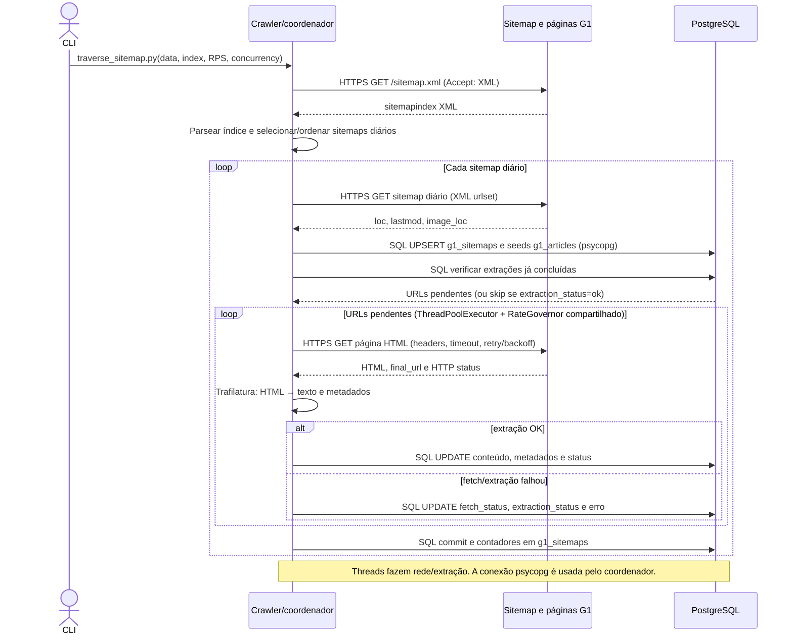
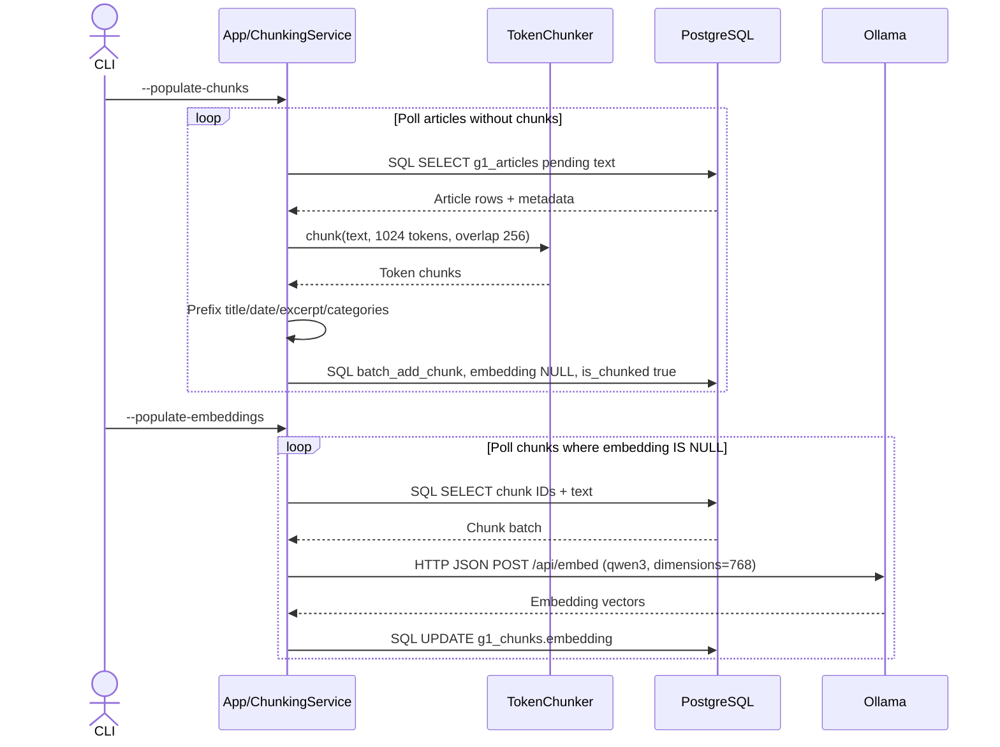
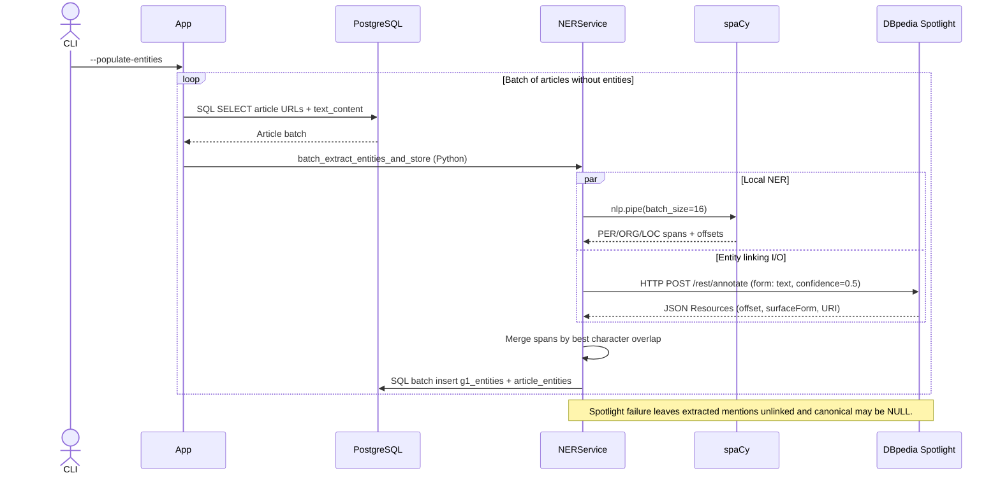
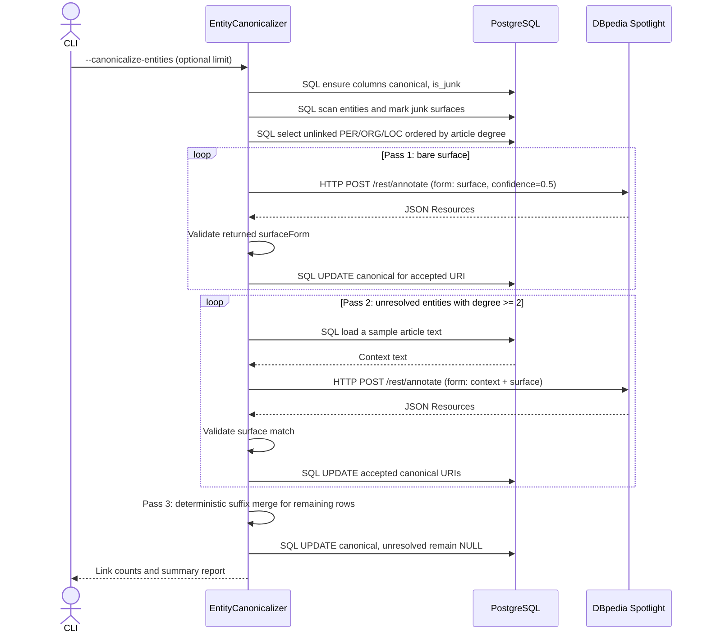
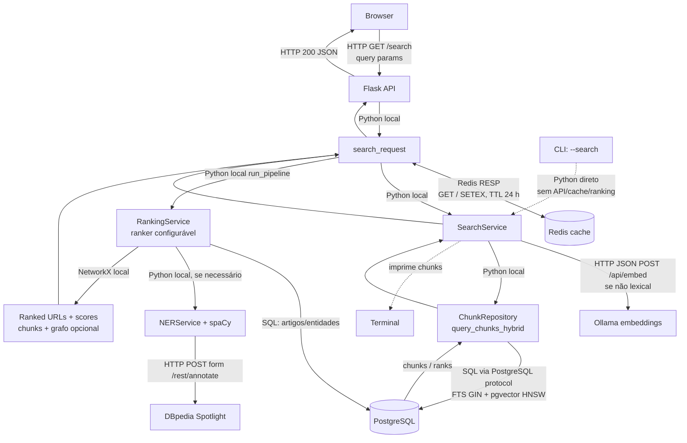

# Fluxos técnicos dos módulos G1

Estes diagramas detalham aquisição do corpus, preparação dos artigos, reconhecimento e resolução de entidades e busca web. Os rótulos nas setas identificam chamadas locais, protocolos de rede e persistência.

> Escopo: `traverse_sitemap.py` é o crawler do corpus G1. `get_data.py` ingere arquivos GDELT ZIP e `get_titles.py` enriquece URLs desse conjunto; são pipelines diferentes e não estão misturados ao crawler G1 abaixo.

Para as variantes sem cache Redis e sem o caminho CLI, consulte [`docs/fluxos_modulos_tecnicos_sem_redis_cli.md`](fluxos_modulos_tecnicos_sem_redis_cli.md).

## 1. Web scraping G1: sitemap → artigo → PostgreSQL

**Entrada:** índice/sitemaps do G1 e parâmetros como data, concorrência e limites.  
**Saída:** registros de `g1_sitemaps` e artigos com conteúdo, metadados e status em `g1_articles`.

O crawler mantém um rate governor agregado mesmo com fetch paralelo. Os workers fazem rede/extração; o coordenador usa psycopg para persistir status e conteúdo.

## 2. Chunking do artigo e geração de embeddings

**Entrada:** `g1_articles.text_content` e metadados.  
**Saída:** chunks em `g1_chunks`; em um comando posterior, embeddings de 768 dimensões.

Chunking e vetorização são comandos separados: o primeiro persiste texto com embedding nulo; o segundo busca esses chunks e grava os vetores.

## 3. Extração de nomes e linking inicial

**Entrada:** corpos textuais de artigos sem entidades.  
**Saída:** menções tipadas e relações artigo-entidade; o link canônico pode ficar nulo se não houver correspondência.

spaCy e as chamadas I/O ao Spotlight correm em paralelo durante o processamento em lote. O merge usa offsets; a indisponibilidade do Spotlight não impede a extração local.

## 4. Linking/canonicalização de entidades existentes

**Entrada:** entidades `PER`, `ORG` e `LOC` ainda não canônicas.  
**Saída:** `canonical` com URI DBpedia, `is_junk` atualizado ou entidade mantida sem link.

O canonicalizer é um backfill distinto do linking inicial do NER: ele marca lixo e tenta resolver menções que ficaram sem URI, primeiro pela superfície, depois pelo contexto e por fim por uma regra determinística de sufixo.

## 5. Busca web: módulos e protocolos

**Entrada:** `GET /search` com consulta e parâmetros.  
**Saída:** HTTP JSON com chunks/artigos ordenados, scores, diagnósticos e, se aplicável, grafo.

As chamadas entre serviços Python são locais ao processo — não REST. As fronteiras de rede são a API Flask, Ollama, Spotlight, Redis e PostgreSQL. O caminho CLI é diferente da busca web: chama `SearchService.search` diretamente e imprime chunks; não executa o pipeline de ranking da API.

## Exportações para o TCC

Os SVGs vetoriais e PNGs a 300 dpi foram dimensionados para a área útil de A4, com margens de 12 mm. A orientação varia conforme a proporção do diagrama.

| Diagrama | Tamanho / página | SVG | PNG (300 dpi) |
|---|---:|---|---|
| Scraping G1 | 214,9 × 186 mm, paisagem | [SVG](figuras/fluxos_modulos_tecnicos/01_scraping_g1_A4_landscape.svg) | [PNG](figuras/fluxos_modulos_tecnicos/01_scraping_g1_A4_landscape_300dpi.png) |
| Chunking e embeddings | 231,7 × 186 mm, paisagem | [SVG](figuras/fluxos_modulos_tecnicos/02_chunking_embeddings_A4_landscape.svg) | [PNG](figuras/fluxos_modulos_tecnicos/02_chunking_embeddings_A4_landscape_300dpi.png) |
| Extração e linking inicial | 273 × 140,6 mm, paisagem | [SVG](figuras/fluxos_modulos_tecnicos/03_extracao_linking_inicial_A4_landscape.svg) | [PNG](figuras/fluxos_modulos_tecnicos/03_extracao_linking_inicial_A4_landscape_300dpi.png) |
| Canonicalização de entidades | 193,2 × 186 mm, paisagem | [SVG](figuras/fluxos_modulos_tecnicos/04_canonicalizacao_entidades_A4_landscape.svg) | [PNG](figuras/fluxos_modulos_tecnicos/04_canonicalizacao_entidades_A4_landscape_300dpi.png) |
| Busca e protocolos | 197,9 × 186 mm, paisagem | [SVG](figuras/fluxos_modulos_tecnicos/05_busca_protocolos_A4_landscape.svg) | [PNG](figuras/fluxos_modulos_tecnicos/05_busca_protocolos_A4_landscape_300dpi.png) |
