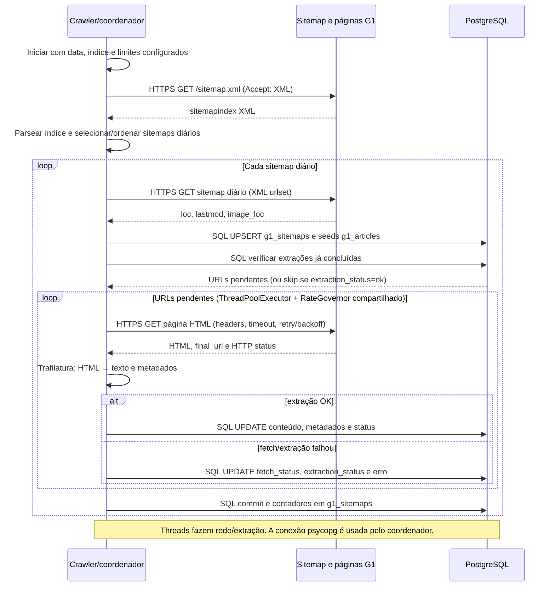
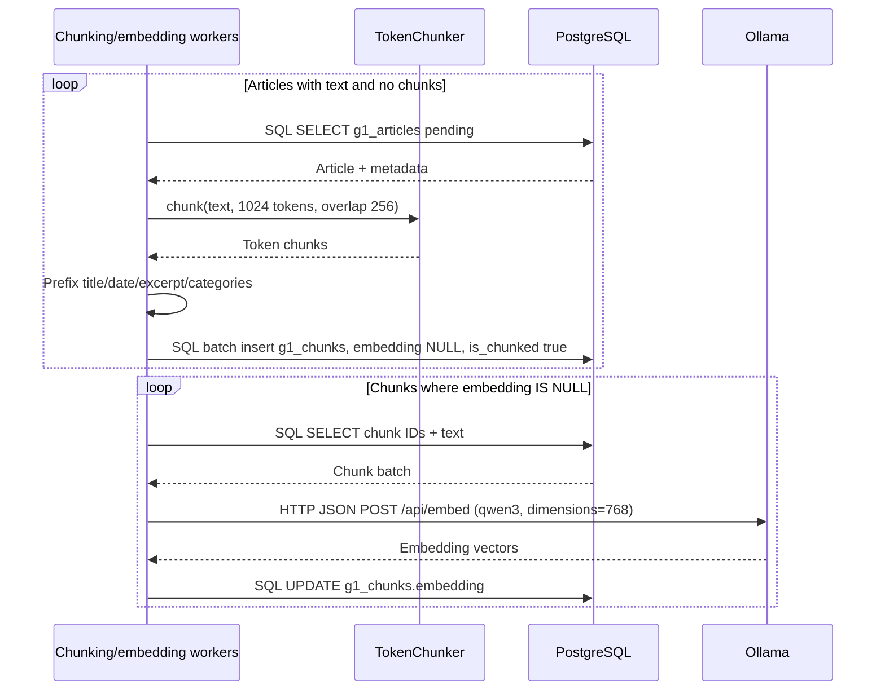
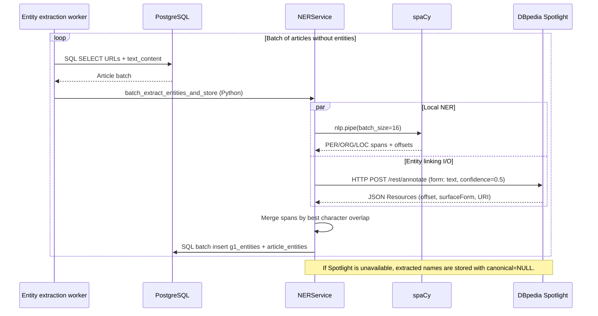
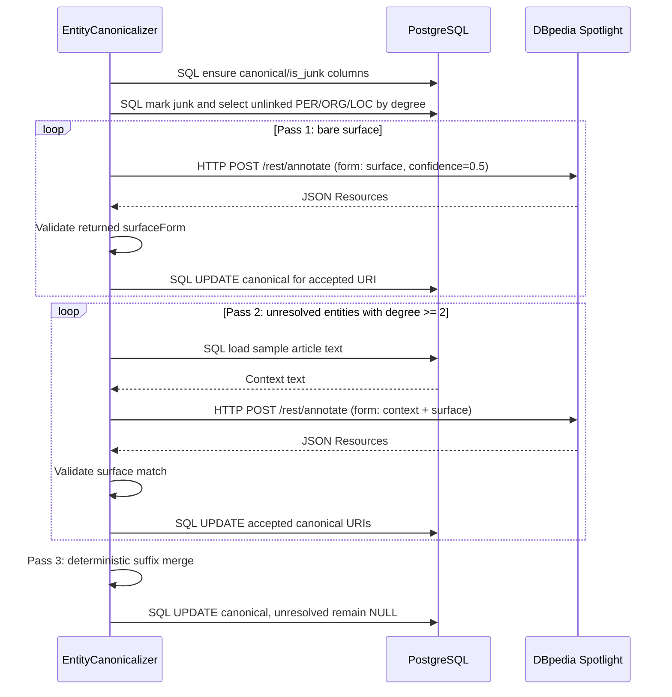
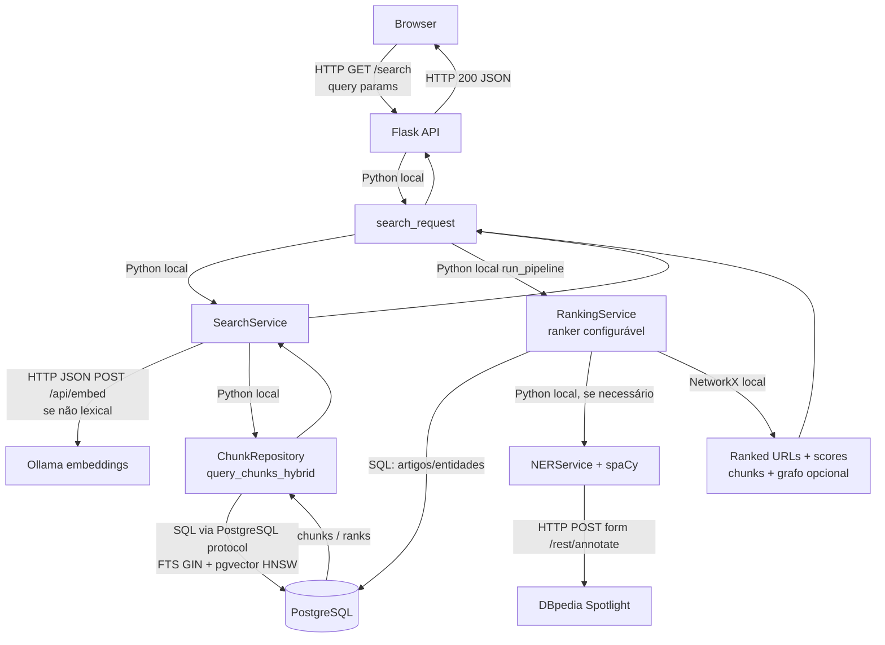

# Fluxos técnicos dos módulos G1 — sem cache e sem CLI

Versões alternativas dos cinco diagramas técnicos. Os fluxos mantêm a aquisição, transformação e persistência de dados, mas não mostram a invocação por CLI nem o cache Redis.

Versão com cache e caminhos CLI: [`docs/fluxos_modulos_tecnicos.md`](fluxos_modulos_tecnicos.md).

## 1. Web scraping G1

## 2. Chunking e embeddings

## 3. Extração de nomes e linking inicial

## 4. Canonicalização de entidades

## 5. Busca web: módulos e protocolos

As chamadas entre serviços Python permanecem locais ao processo. A busca web usa HTTP para a API, Ollama e Spotlight e SQL pelo protocolo PostgreSQL para os dados.

## Exportações para o TCC

Os SVGs vetoriais e PNGs a 300 dpi foram dimensionados para a área útil de A4, com margens de 12 mm.

| Diagrama | Tamanho / página | SVG | PNG (300 dpi) |
|---|---:|---|---|
| Scraping G1 | 186 × 211,8 mm, retrato | [SVG](figuras/fluxos_modulos_tecnicos_sem_redis_cli/01_scraping_g1_A4_portrait.svg) | [PNG](figuras/fluxos_modulos_tecnicos_sem_redis_cli/01_scraping_g1_A4_portrait_300dpi.png) |
| Chunking e embeddings | 218,8 × 186 mm, paisagem | [SVG](figuras/fluxos_modulos_tecnicos_sem_redis_cli/02_chunking_embeddings_A4_landscape.svg) | [PNG](figuras/fluxos_modulos_tecnicos_sem_redis_cli/02_chunking_embeddings_A4_landscape_300dpi.png) |
| Extração e linking inicial | 273 × 155,3 mm, paisagem | [SVG](figuras/fluxos_modulos_tecnicos_sem_redis_cli/03_extracao_linking_inicial_A4_landscape.svg) | [PNG](figuras/fluxos_modulos_tecnicos_sem_redis_cli/03_extracao_linking_inicial_A4_landscape_300dpi.png) |
| Canonicalização de entidades | 186 × 205 mm, retrato | [SVG](figuras/fluxos_modulos_tecnicos_sem_redis_cli/04_canonicalizacao_entidades_A4_portrait.svg) | [PNG](figuras/fluxos_modulos_tecnicos_sem_redis_cli/04_canonicalizacao_entidades_A4_portrait_300dpi.png) |
| Busca e protocolos | 186 × 215,8 mm, retrato | [SVG](figuras/fluxos_modulos_tecnicos_sem_redis_cli/05_busca_protocolos_A4_portrait.svg) | [PNG](figuras/fluxos_modulos_tecnicos_sem_redis_cli/05_busca_protocolos_A4_portrait_300dpi.png) |
